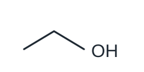

# Công thức và ion

Chọn đáp án đúng. Dùng nút **Kiểm tra** để xem kết quả của từng câu.

## Công thức hoá học của axit sunfuric là gì? {type=single id=axit-sunfuric tags=cong-thuc}

- [ ] $\ce{H2SO3}$
- [x] $\ce{H2SO4}$
- [ ] $\ce{H2S}$
- [ ] $\ce{HSO4-}$

::: hint
Phân tử có hai nguyên tử hiđro, một nguyên tử lưu huỳnh và bốn nguyên tử oxi.
:::

::: explanation
Axit sunfuric là $\ce{H2SO4}$. $\ce{H2SO3}$ là axit sunfurơ (ít oxi hơn một nguyên tử), $\ce{H2S}$ là hiđro sunfua không chứa oxi, còn $\ce{HSO4-}$ là ion hiđrosunfat, tức là phân tử $\ce{H2SO4}$ đã mất một ion $\ce{H+}$.
:::

## Ion sunfat có công thức nào? {type=single id=ion-sunfat tags=cong-thuc}

- [ ] $\ce{SO3^2-}$
- [ ] $\ce{HSO4-}$
- [x] $\ce{SO4^2-}$
- [ ] $\ce{S^2-}$

::: explanation
Ion sunfat là $\ce{SO4^2-}$: một nguyên tử lưu huỳnh, bốn nguyên tử oxi và điện tích $2-$, vì $\ce{H2SO4}$ nhường đi hai ion $\ce{H+}$. $\ce{SO3^2-}$ là ion sunfit, $\ce{HSO4-}$ là ion hiđrosunfat (mới nhường một ion $\ce{H+}$) và $\ce{S^2-}$ là ion sunfua.
:::

## Hình dưới là công thức khung của một chất hữu cơ. Chất đó là gì? {type=single id=cong-thuc-khung tags=huu-co}

{width=240}

- [ ] Axit axetic, $\ce{CH3COOH}$
- [ ] Anđehit axetic, $\ce{CH3CHO}$
- [x] Etanol, $\ce{C2H5OH}$
- [ ] Đimetyl ete, $\ce{CH3OCH3}$

::: explanation
Trong công thức khung, mỗi đầu đoạn thẳng và mỗi chỗ gấp là một nguyên tử cacbon, kèm các nguyên tử hiđro đủ hoá trị. Hai đoạn thẳng cho hai nguyên tử cacbon, và nhóm $\ce{-OH}$ gắn vào cacbon cuối: $\ce{CH3-CH2-OH}$, tức là etanol, $\ce{C2H5OH}$.
:::

## Nối mỗi kí hiệu với ý nghĩa của nó. {type=matching id=trang-thai points=4 tags=cong-thuc}

- $\ce{CuSO4.5H2O}$ :: muối ngậm nước, tinh thể màu xanh lam
- $\ce{NaCl(aq)}$ :: natri clorua tan trong nước
- $\ce{H2O(g)}$ :: hơi nước
- $\ce{Fe(s)}$ :: sắt ở thể rắn
- :: khí hiđro

::: explanation
Chữ trong ngoặc là trạng thái: $\text{(s)}$ rắn, $\text{(l)}$ lỏng, $\text{(g)}$ khí, $\text{(aq)}$ tan trong nước. Dấu chấm trong $\ce{CuSO4.5H2O}$ nối muối với năm phân tử nước kết tinh. Khí hiđro là $\ce{H2(g)}$, không có kí hiệu nào ở trên.
:::

## Nhóm chức đặc trưng của axit axetic, $\ce{CH3COOH}$, có tên là gì? {type=short id=nhom-chuc tags=huu-co}

```answer
accept: ["cacboxyl", "nhóm cacboxyl", "carboxyl", "nhóm carboxyl", "-COOH", "COOH", "nhóm -COOH"]
```

::: explanation
$\ce{CH3COOH}$ có nhóm cacboxyl, $\ce{-COOH}$. Chính nhóm này làm cho nó có tính axit: nó nhường ion $\ce{H+}$ và còn lại ion axetat, $\ce{CH3COO-}$.
:::

# Phản ứng và tính toán

Bảng khối lượng mol nằm trong **Tài liệu**. Số liệu lấy tròn như trong bảng.

## Cân bằng phương trình: [[=4]] $\ce{Fe}$ + [[=3]] $\ce{O2}$ → [[=2]] $\ce{Fe2O3}$ {type=blanks id=can-bang points=3 tags=phuong-trinh}

::: explanation
Mỗi vế phải có cùng số nguyên tử của từng nguyên tố. Số nguyên tử oxi ở vế phải là bội của 3 (mỗi $\ce{Fe2O3}$ có 3), ở vế trái là số chẵn (mỗi $\ce{O2}$ có 2), nên lấy bội chung nhỏ nhất là 6: cần $2\,\ce{Fe2O3}$ và $3\,\ce{O2}$. Hai phân tử $\ce{Fe2O3}$ chứa 4 nguyên tử $\ce{Fe}$, nên cần $4\,\ce{Fe}$: $$\ce{4Fe + 3O2 -> 2Fe2O3}$$
:::

## Nung 10 g $\ce{CaCO3}$ theo phương trình $\ce{CaCO3 ->[t^\circ] CaO + CO2 ^}$. Khối lượng $\ce{CO2}$ thu được là bao nhiêu gam? {type=numeric id=khoi-luong-co2 points=2 tags=tinh-toan}

```answer
value: 4.4
tolerance: 0.05
unit: g
```

::: hint
Tính số mol $\ce{CaCO3}$ bằng $n = m / M$, rồi dùng tỉ lệ 1 : 1 của phương trình.
:::

::: explanation
$M(\ce{CaCO3}) = \pu{100 g/mol}$ nên $n(\ce{CaCO3}) = 10 / 100 = \pu{0,1 mol}$. Phương trình cho tỉ lệ 1 : 1, vậy $n(\ce{CO2}) = \pu{0,1 mol}$. Với $M(\ce{CO2}) = \pu{44 g/mol}$, khối lượng là $m(\ce{CO2}) = 0{,}1 \times 44 = \pu{4,4 g}$.
:::

## Phản ứng tổng hợp amoniac $\ce{N2 + 3H2 <=> 2NH3}$ toả nhiệt. Những tác động nào làm cân bằng chuyển dịch theo chiều thuận, tạo thêm $\ce{NH3}$? {type=multi id=can-bang-hoa-hoc points=3 tags=can-bang}

- [x] Tăng áp suất của hệ
- [ ] Tăng nhiệt độ
- [x] Tách $\ce{NH3}$ ra khỏi hỗn hợp khi nó tạo thành
- [ ] Thêm chất xúc tác
- [x] Thêm $\ce{N2}$

::: explanation
Theo nguyên lí Le Chatelier, cân bằng chuyển dịch để làm giảm tác động. Tăng áp suất thì cân bằng chuyển về phía có ít mol khí hơn: 4 mol khí ở vế trái, 2 mol ở vế phải, nên chuyển theo chiều thuận. Tách $\ce{NH3}$ hoặc thêm $\ce{N2}$ cũng làm cân bằng chuyển theo chiều thuận. Phản ứng toả nhiệt, nên tăng nhiệt độ làm cân bằng chuyển theo chiều nghịch. Chất xúc tác làm phản ứng nhanh đạt cân bằng hơn nhưng không làm cân bằng chuyển dịch.
:::

## Với $\Delta H = \pu{-92 kJ/mol}$ (tính theo phương trình đã viết), phản ứng $\ce{N2 + 3H2 <=> 2NH3}$ là phản ứng toả nhiệt. {type=truefalse id=toa-nhiet points=1 tags=can-bang}

```answer
value: true
```

::: explanation
$\Delta H$ âm nghĩa là hệ toả nhiệt ra môi trường, nên đây là phản ứng toả nhiệt.
:::
